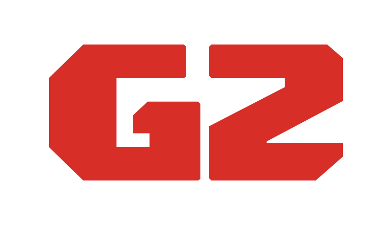

# G2-OS

G2-OS is the system image of the **Ginger G2** pellet 3D printer. It is not an
application: it is a set of customisation scripts that run inside the chroot of
an official Raspberry Pi OS image and turn it into a machine that boots straight
into the printer's operator interface.

It is a fork of [MainsailOS](https://github.com/mainsail-crew/MainsailOS), with
three substitutions:

| MainsailOS | G2-OS | Why |
|---|---|---|
| Klipper | **[Kalico](https://github.com/KalicoCrew/kalico)** | Klipper fork, required for pellet extrusion |
| Mainsail | **[GingerView](https://github.com/gingeradditive/GingerView)** | The G2 operator interface |
| — | **[G2-Service](https://github.com/gingeradditive/G2-Service)** | The machine's local backend (Wi-Fi, timezone, configuration) |

The rest of the MainsailOS stack — Moonraker, Crowsnest, Sonar, nginx — is
inherited almost unchanged. Staying close to upstream is a deliberate goal: the
smaller the divergence, the cheaper it is to pull in their work.

## Target hardware

**Raspberry Pi 4 Model B, 64-bit, only.** `config.yml` builds a single image.
Upstream's 32-bit Pi, Orange Pi and BigTreeTech CB1 targets are not carried here
because we neither ship nor test that hardware.

## Reaching the machine

The printer is reached over mDNS at **`http://g2.local`**, which is what the
QR/NFC tag on the machine points to. GingerView is served by nginx on port 80,
with Moonraker proxied on the same origin, so neither a browser nor GingerSlicer
ever has to name a port:

| Path | Goes to |
|---|---|
| `/` | GingerView (SPA, `try_files … /index.html`) |
| `/websocket` | Moonraker |
| `/printer/`, `/api/`, `/access/`, `/machine/`, `/server/` | Moonraker |
| `/service/` | G2-Service |

The `/service/` location is not written by this repository: every G2 service
drops its own `location` into `/etc/nginx/g2-locations.d/`, which the GingerView
site includes. That is why changing one service's paths never means editing a
file that lives in another repository.

## What is installed

### Core stack

-   **[Kalico](https://github.com/KalicoCrew/kalico)** in `~/kalico`, venv
    `~/kalico-env`, unit `kalico.service`.
-   **[Moonraker](https://github.com/Arksine/moonraker)** — the API server.
-   **[GingerView](https://github.com/gingeradditive/GingerView)** in
    `~/GingerView`, served by nginx from its committed `build/` directory.
-   **[G2-Service](https://github.com/gingeradditive/G2-Service)** in
    `~/G2-Service`, on `:8000`, proxied at `/service/`.
-   **[Crowsnest](https://github.com/mainsail-crew/crowsnest)** — webcam streamer.
-   **[Sonar](https://github.com/mainsail-crew/sonar)** — Wi-Fi keepalive daemon.
-   **[KAMP](https://github.com/kyleisah/Klipper-Adaptive-Meshing-Purging)** —
    adaptive meshing and purging macros, linked at `printer_data/config/KAMP`.
-   **[Nginx](https://nginx.org/)** — web server and reverse proxy.

### Machine conveniences

-   **Ready-to-use UART** — the hardware serial port (PL011) is enabled and the
    serial console disabled, so the printer board connects without a USB cable.
-   **Input Shaper ready** — Kalico's Python dependencies are pre-installed.
-   **Katapult support** — `python3-serial` is included.
-   **USB stick auto-mount** — a stick is mounted read-only under `/media` and
    surfaces inside the gcode folder, so an operator can print from it without a
    terminal.
-   **Boot splash** — the G2 logo replaces the kernel log on boot.

## Building

Every push to `main` builds an image through GitHub Actions and uploads it as a
workflow artifact. To publish a release, trigger the `Release` workflow manually
with a SemVer version.

There is no supported local build; the image is produced by
[CustoPiZer](https://github.com/OctoPrint/CustoPiZer) in CI.

### How the build is put together

`config.yml` declares the target. The workflow flattens `modules/generic/` and
`modules/raspberry/` into one directory and CustoPiZer runs the scripts in name
order inside the image's chroot:

| Module | What it does |
|---|---|
| `10-config-raspberry` | Boot config, UART, I2C, swap, user setup |
| `30-headless-nm`, `31-wifi-powersave-off` | Networking |
| `32-canbus` | CAN interface |
| `50-kalico` | Kalico + venv + `kalico.service` |
| `51-moonraker` | Moonraker + `moonraker.conf` |
| `52-gingerview` | Clones GingerView and runs its own `script/install.sh` |
| `53-crowsnest`, `54-timelapse`, `55-sonar` | Webcam, timelapse, keepalive |
| `56-kamp` | KAMP macros |
| `60-mainsailos` | Release file, hostname `g2`, shared dependencies |
| `61-postrename-cloudinit` | First-boot user rename (cloud-init) |
| `62-EnableUSB` | USB stick auto-mount |
| `63-SplashScreen` | Boot splash |
| `69-G2-Service` | Clones G2-Service and runs its installer |
| `98-remove-passwordless-sudo` | Restores the sudo password |

Two modules deliberately delegate to the installer of the repository they are
installing (`52-gingerview`, `69-G2-Service`) rather than reimplementing it:
those installers are tested in their own repositories and are written to run
unattended inside a build chroot.

### First boot and the user rename

The image ships with the build-time user `pi`. If the Raspberry Pi Imager is
told to use a different username, cloud-init renames it on first boot and
`/usr/local/lib/mainsailos/postrename-lib` rewrites the paths that embed the old
one: systemd units, `.env` files, venv shebangs, the nginx site and the
symlinks. **A first boot with a username other than `pi` is the single most
valuable thing to test on a new image.**

## Licence

Inherited from MainsailOS — see [LICENSE](LICENSE).
